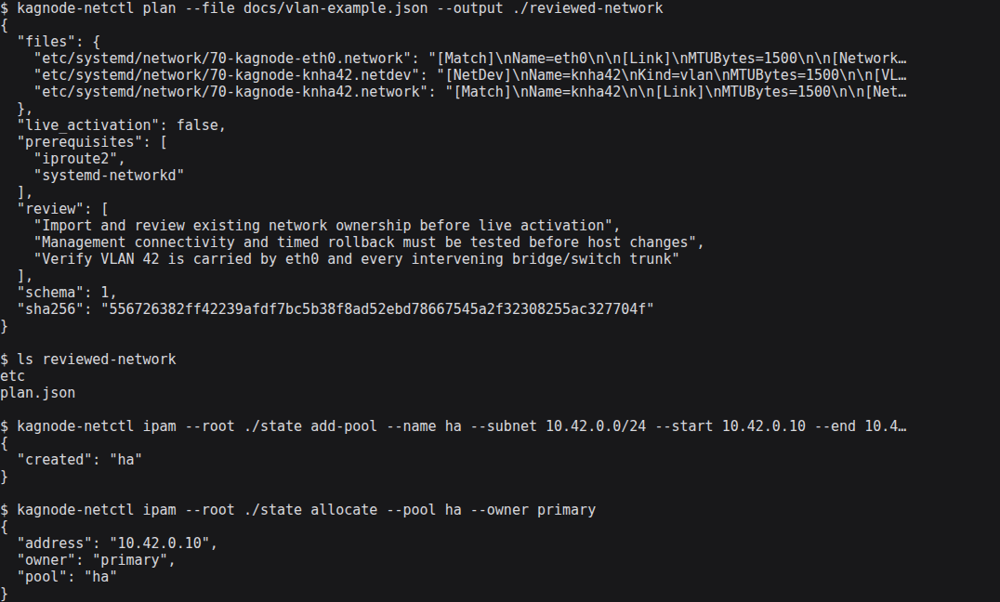

<p align="center"></p>

# KagNode. Network

_Formerly KagNode. Netctl. The repository (`kagnode-netctl`), crate, executable (`kagnode-netctl`), configuration and state paths (`/srv/kagnode/netctl`, `/etc/kagnode/netctl`), JSON product identifier and published history keep their original identifiers._

Rust tooling for inspected, reviewable Linux networking and network services.

## Overview

A plan run from the repository's VLAN example, followed by an IP allocation, in a throwaway directory.



| Step                       | Detail                                                                                                                                    |
| -------------------------- | ----------------------------------------------------------------------------------------------------------------------------------------- |
| Declare                    | You describe the wanted network (VLANs, bridges, bonds, addresses, routes, DNS) in typed JSON.                                            |
| Plan                       | `plan` validates the declaration and writes a fresh directory with the configuration files for systemd-networkd, Kea, Unbound, Knot DNS,… |
| Review                     | The plan states `live_activation: false` and lists what a person must check first, such as whether a switch trunk carries the VLAN.       |
| Nothing is applied for you | Netctl only reads the host and writes files into a new directory.                                                                         |
| IPAM                       | Address pools and allocations are kept in a private SQLite file.                                                                          |

## Release status

**5.0.0 source preview.** Host inspection, typed configuration planning and persistent IPAM have automated coverage. Plans render owned configuration files; live host activation, automatic HA, physical-switch changes and Proxmox writes remain blocked until their transaction and recovery adapters are qualified. A generated plan is not a successful network change.

## Features

- Bounded read-only interface, address, route and service inventory.
- Validated VLAN, bridge, bond, address, route and DNS-client declarations.
- Configuration output for systemd-networkd, Kea DHCPv4, Unbound, Knot DNS, FRR BGP and an owned nftables table.
- Persistent IPv4/IPv6 IPAM allocation windows with unique, idempotent allocation and explicit release.
- Deterministic plan hashes, fresh output directories, input bounds and source-visible validation.
- HA VLAN/trunk requirements appear in the plan.

## Requirements

Rust 1.88 or newer for development. Linux inspection needs `iproute2` and systemd.

## Installation and downloads

| Payload                               | Formats                                        | Qualification                                     |
| ------------------------------------- | ---------------------------------------------- | ------------------------------------------------- |
| Editable source                       | Git checkout; GitHub source `.zip` / `.tar.gz` | Preview; see validation scope                     |
| Application and distribution packages | `.deb`, `.rpm`, `.tar.xz`, `.tar.gz`, `.zip`   | Release packaging pending native lifecycle checks |

## Usage

```sh
kagnode-netctl capabilities
kagnode-netctl inspect
kagnode-netctl plan --file docs/vlan-example.json --output ./reviewed-network
kagnode-netctl ipam --root /srv/kagnode/netctl add-pool --name ha --subnet 10.42.0.0/24 --start 10.42.0.10 --end 10.42.0.50
kagnode-netctl ipam --root /srv/kagnode/netctl allocate --pool ha --owner primary
```

## Configuration and storage

Declarations use typed JSON with unknown fields rejected. IPAM stores private SQLite state beneath the explicitly selected root, default `/srv/kagnode/netctl`.

## Security

All external commands have fixed read-only argument arrays, time/output bounds and no shell interpolation. Generated names and paths are validated.

## Development and testing

```sh
cargo fmt --check
cargo clippy --locked --all-targets -- -D warnings
cargo test --locked
```

## Documentation

|                                        |                                                  |
| -------------------------------------- | ------------------------------------------------ |
| Architecture and validation boundaries | [docs/ARCHITECTURE.md](docs/ARCHITECTURE.md)     |
| VLAN declaration                       | [docs/vlan-example.json](docs/vlan-example.json) |
| Repository layout                      | [docs/STRUCTURE.md](docs/STRUCTURE.md)           |
| Changelog                              | [CHANGELOG.md](CHANGELOG.md)                     |

## Licensing

Code: **AGPL-3.0-only**, see [LICENSE](LICENSE). Artwork follows its [separate notice](assets/ARTWORK-LICENSE).
